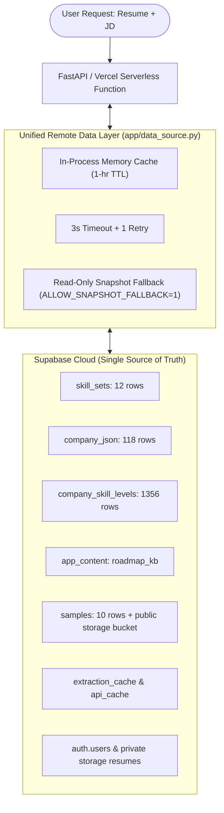

# Cairn v3: Cloud-Native Engineering Talent Match & ATS Integrity Engine

> **Single-user candidate intelligence engine: One Person, One Resume, One Job Description.**  
> Built for precision match scoring, benchmark company calibration, ATS cheat detection, and deterministic roadmaps.  
> **Supabase is the single source of truth for all reference data, storage, and persistence.**

---

## 🎯 Architecture Overview

Radix v3 operates with a completely unified remote data layer (`app/data_source.py`):



---

## 🚀 Quickstart

Run these commands in PowerShell from `d:\radix_v3`:

```powershell
# 1. Activate the virtual environment
d:\radix_v2\.venv\Scripts\activate

# 2. Seed Supabase (Dry run first, then live)
python scripts/seed_supabase.py --dry-run
python scripts/seed_supabase.py

# 3. Verify remote database integrity against seed files
python scripts/verify_remote.py

# 4. Run the automated test suite (55 tests)
pytest

# 5. Start the local server (port 8000)
python -m uvicorn app.api:app --reload --port 8000
```

---

## 📡 API Endpoints

### 1. `GET /health`
Exposes the health and live source of all critical subsystems:
```json
{
  "status": "ok",
  "data_source": "supabase",
  "companies": 118,
  "levels": 1356,
  "skill_sets": 12,
  "storage": "supabase",
  "auth": "supabase",
  "llm": true,
  "github_token": false,
  "provider": "gemini",
  "model": "gemini-3.5-flash-lite",
  "engine": "Gemini · gemini-3.5-flash-lite",
  "active": true
}
```

### 2. `GET /companies`
Returns all 113 benchmark companies with complete 12 skill levels sorted alphabetically.

### 3. `GET /samples`
Returns metadata and the default sample pair for the interactive "Try with a sample" experience.

### 4. `GET /samples/file/{kind}/{filename}`
Streams sample resume and JD PDFs directly from the Supabase public storage bucket.

### 5. `POST /analyze`
Executes the full candidate evaluation pipeline statelessly with isolated error handling and per-step timings.

---

## 📦 Zero-Data Vercel Deployment

- `vercel.json` contains no local `data/**` inclusions.
- Raw CSVs, PDFs, and cache files are moved to `seed/` and excluded via `.vercelignore`.
- Serverless function deployments remain tiny and deploy in seconds.
