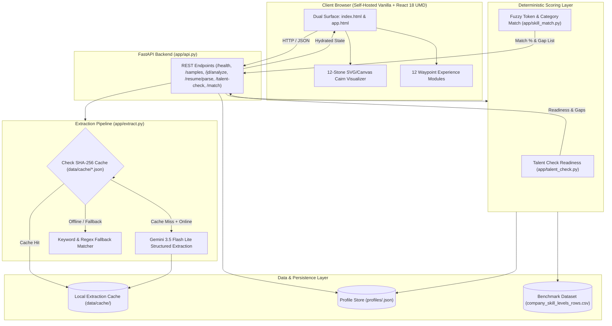

# Cairn System Architecture & Design Decisions

## System Flow & Data Pipeline

---

## Key Architectural & Design Decisions

### 1. Deterministic Multi-Tier Caching (`data/cache/`)
- **Decision:** Every document extraction is hashed via SHA-256 over raw content bytes, document kind, and model identifier, storing validated JSON schemas in `data/cache/`.
- **Rationale:** AI inference is inherently stochastic, subject to network latency, and prone to API quota exhaustion or upstream service disruptions. Hashing guarantees sub-millisecond response times during hackathon demos, eliminates token consumption for verified benchmarks, and enables 100% offline demonstration reliability without sacrificing real-model verification when online.

### 2. Purely Deterministic Mathematical Scoring Over LLM Scoring
- **Decision:** Scoring is computed exclusively through deterministic Python algorithms in `app/talent_check.py` and `app/skill_match.py`, rather than asking an LLM to "estimate a score out of 100".
- **Rationale:** LLMs are notorious for score drifting, prompt sensitivity, and hallucinations when calculating numeric metrics. By restricting the LLM strictly to information extraction and using auditable mathematical formulas for scoring, results are 100% reproducible, explainable, transparent to candidates and hiring managers, and zero-latency.

### 3. Asymmetric Readiness Weighting by Required Benchmark Level ($R_i^2$)
- **Decision:** The Talent Check formula weights readiness by the required hiring level:
  $$\text{Readiness Score} = 100 \times \frac{\sum_{i} \min(C_i, R_i) \cdot R_i}{\sum_{i} R_i^2}$$
- **Rationale:** Harder competencies demanded by top employers (e.g., Level 9 DSA or Distributed Systems at Google) must carry proportionally greater weight than auxiliary skills. Crucially, the $\min(C_i, R_i)$ ceiling enforces that a candidate's surplus in an easier skill (e.g., Level 10 in SQL) cannot offset critical deficiencies in fundamental engineering bars. Deficits remain deficits.

### 4. Empirical Benchmark Grounding (113 Companies Verified 100%)
- **Decision:** The 12 competency codes (`COD`, `DSA`, `APTI`, `COMM`, `OOD`, `AI`, `SQL`, `SYSD`, `CLOUD`, `SWE`, `NETW`, `OS`) are directly mapped to numeric `skill_set_id` 1–12 from `company_skill_levels_rows.csv`, verified across all 113 corporate benchmark datasets.
- **Rationale:** Rather than inventing theoretical rubrics, candidate readiness is calibrated against real-world employer baseline requirements across three distinct market tiers: Tier-1 Tech Giants (Google), Enterprise Enterprise Platforms (Microsoft), and Financial Software Services (Oracle FSS).

### 5. Two-Tiered Hybrid Matching: Token-Set Fuzzy Matching with Category Fallback
- **Decision:** Skill Matching in `app/skill_match.py` uses RapidFuzz `token_set_ratio` with an 80% threshold for direct technology matches (e.g., "PostgreSQL" vs "SQL"), while awarding 70% partial credit if the candidate possesses a demonstrated competency within the exact same RADIX category code.
- **Rationale:** Modern job descriptions frequently use idiosyncratic nomenclature for identical competencies (e.g., "Relational Database Design" vs "Production SQL Querying"). Pure exact string matching severely undercounts qualified applicants, whereas uncontrolled semantic vector distance causes false positive matches. Combining fuzzy token analysis with category-level containment ensures compassionate, accurate matching with precise gap diagnostics.
